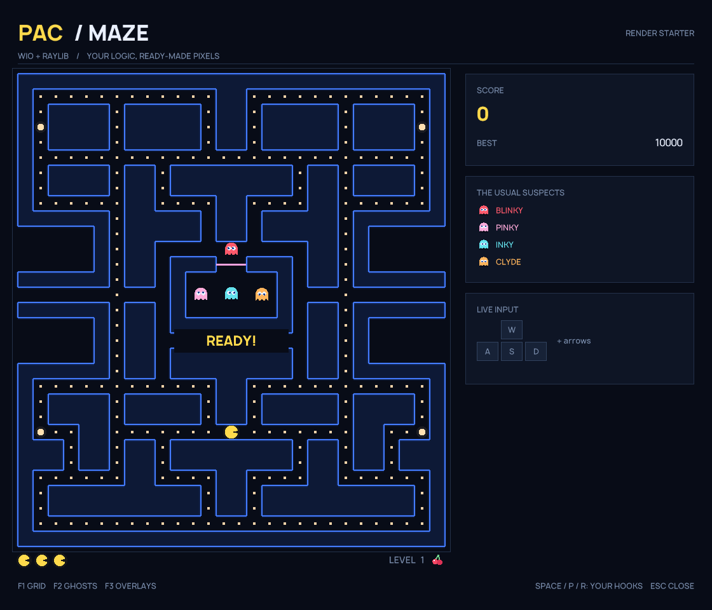

# Pacman rendering starter

A Pacman-style scene drawn in Wio with raylib. The maze, pellets, power pellets,
cherries, animated player and ghosts, score/lives/level HUD, and ready/pause/win/
game-over overlays are ready. **Gameplay is intentionally not implemented.**
Movement, collisions, pellet consumption, score rules, timers and ghost AI belong
to your code in `wio/logic.wio`.



## Run

From this directory:

```powershell
wio project run
```

Or from the repository root:

```powershell
wio project run --project examples/pacman_starter
```

This manifest uses the existing Windows x64 MinGW raylib headers/library in
`../atlas_desk/native`. No download or duplicated library is needed. Keep the
two example directories in their current relative locations. Raylib's license
notice is in `../atlas_desk/LICENSES/raylib-zlib.txt`. Other platforms need their
own raylib build and platform libraries in the manifest.

The UI uses bundled Manrope Medium and Bold fonts, with bilinear filtering and
matching text measurement. Their SIL Open Font License is in
`LICENSES/Manrope-OFL.txt`. The scene uses procedural shapes, without image or
audio downloads. The window is resizable;
the maze and side panel adapt down to 800 by 780 pixels.

## Connect your logic

`logic.Start(state)` runs once. `logic.Update(state, input, delta)` runs every
frame, before drawing. `delta` is seconds, capped at 0.05. `GameState` is an
object, so assignments made through that parameter update the rendered scene.

```wio
fn Update(state: GameState, input: InputFrame, delta: f32) {
    // A minimal example only; add your own wall checks and movement rules.
    if (input.actionPressed) state.phase = Phase::playing;
    if (input.right) {
        state.player.direction = Direction::right;
        state.player.position.x += 3.0f32 * delta;
    }

}
```

The renderer reads state without moving actors or mutating gameplay. It owns
only visual effects: mouth animation, ghost bob/skirt animation and power-pellet
pulses. Fractional positions work, so your logic can interpolate smoothly.

| State | Meaning |
| --- | --- |
| `player.position.x/y` | Tile coordinates; `(0, 0)` is the center of the top-left tile, not pixels |
| `player.direction` | `right`, `down`, `left`, `up`, `none` |
| `player.visible` | Whether to draw the player |
| `ghosts[index].actor` | Position, direction and visibility of a ghost |
| `ghosts[index].mode` | `normal`, `frightened` or `eyes` |
| `frightenedFlash` | Flash frightened ghosts between blue and white |
| `score`, `bestScore`, `lives`, `level` | HUD values; the renderer does not calculate them |
| `phase` | `ready`, `playing`, `paused`, `won`, `gameOver` |
| `fruitVisible`, `fruitPosition` | Cherry visibility and tile position |
| `TileAt(x, y)` | Read a tile; out-of-bounds returns `Tile::outside` |
| `SetTile(x, y, value)` | Change a tile; false if out of bounds |
| `Reset()` | Restore the initial scene; call it from your reset logic if wanted |

The map is 28 columns by 31 rows, stored row-major in `tiles`. Layout symbols
in `model.wio` are `#` wall, `.` pellet, `o` power pellet, `-` pen door, `_` empty
floor and space outside the maze. Doors and tunnel wrapping have no built-in
collision behavior; decide those rules in your logic.

## Inputs and visual previews

| Key | Behavior |
| --- | --- |
| Arrow keys or WASD | Held flags in `input.up/down/left/right`; also illuminate the input panel |
| Space or Enter | One-frame `input.actionPressed` |
| P | One-frame `input.pausePressed` |
| R | One-frame `input.resetPressed`; the shell does not reset for you |
| F1 | Toggle tile grid |
| F2 | Preview normal/frightened/eyes graphics without changing actual ghost modes |
| F3 | Preview overlays; cycle back to actual gameplay state |
| Escape | Close the window |

Preview controls belong to the shell's `Presentation`, not `GameState`. The
window therefore stays on the initial scene until you implement logic. Arrow
keys do not secretly move the player, and Space/P/R have no preset game rules.

## Files

- `wio/logic.wio`: your gameplay hook; start here.
- `wio/model.wio`: editable tile map and public scene data.
- `wio/ui.wio`: local panel coordinates, row/column flows, alignment and grid cells.
- `wio/appearance.wio`: named spacing, dimensions, font sizes and palette.
- `wio/renderer.wio`: responsive page composition, maze, HUD and overlays.
- `wio/sprites.wio`: scalable player/ghost/cherry geometry and animation.
- `wio/raylib.wio`: typed native Color/Vector2/Rectangle and raylib declarations.
- `wio/main.wio`: window/input/frame loop and visual-preview controls.
- `native/include/pacman_raylib.h`: C-string, text measurement and owned-font adapters;
  no gameplay or scene renderer lives in C++.

## Relative panels and automatic layout

Each `ui::Area` is a local coordinate space. `Panel` draws its frame and returns
the padded inner area. Enter that area with `Column` or `Row`; `Take` advances
automatically, `TakeEnd` reserves space from the opposite end, and `Rest` returns
what remains. No global current-panel state or matching Begin/End calls are needed.

For example, a score panel can be composed without a single screen position:

```wio
mut sidebar = layout.sidebar.Column(metrics::SectionGap);
let bounds = sidebar.Take(metrics::ScorePanelHeight);
let panel = bounds.Panel(metrics::PanelPadding, colors::Surface(), colors::Border());
mut content = panel.Column(metrics::ItemGap);
content.Label("SCORE", fonts::Caption, colors::Muted());
content.Label($"${state.score}", fonts::Score, colors::Yellow());
let best = content.Take(metrics::ValueRowHeight);
best.Label("BEST", fonts::Caption, colors::Muted(), ui::Align::start, ui::Align::center);
best.Label($"${state.bestScore}", fonts::Value, colors::Ink(), ui::Align::end, ui::Align::center);
```

Remove a card's `Take`/draw call and the following cards move up automatically.
Move or resize a parent and all descendants follow it. The actual sidebar is
three independent functions: `ScoreCard`, `LegendCard` and `InputCard`.

- `Child(x, y, width, height)` is relative to its parent, never the window.
- `Inset` supplies padding; `Sized` aligns a child at start, center or end.
- `Anchor(u, v)` uses normalized coordinates, from top-left `(0, 0)` to
  bottom-right `(1, 1)`; `Center()` is its midpoint.
- `Cell(column, row, columns, rows, gap)` places the keypad without pixel offsets.
- `Label` measures the selected font for alignment and reduces its size if its
  text exceeds the available width. `Line` and `StrokeEdge` use parent coordinates.

`Arrange` is the only viewport-level calculation. It reserves the header/footer,
fits square maze cells, and gives remaining width to the sidebar. Areas are
independent value components, not heap-owned widgets. They provide layout, not
automatic clipping or a scrolling UI framework. Shape proportions and animation
rates remain in `sprites.wio`; they are not page/panel position constants.

## Check layout and rendering

```powershell
wio project test --filter relative_
```

`tests/relative_layout.wio` checks nested coordinates, padding, alignment,
independent cursors, opposite-end allocation, panel removal/reflow and four
viewport sizes without opening a window. `tests/relative_render.wio` opens a
temporary window and captures all visual modes, the minimum window and a large
score into `.wio-build/ui-*.png`. It verifies rendering does not change gameplay
state. Tests stay outside the normal application's entry loop.
